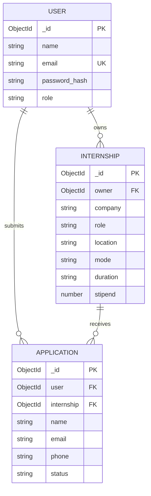

# Internship Management System — API Documentation

Base URL: `http://localhost:5000/api`

For protected routes, send `Authorization: Bearer <JWT>` and `Content-Type: application/json`.
Tokens expire after 24 hours. Public registration creates a `student` account only. Company/admin accounts are provisioned by a trusted operator.

## Authentication

| Method | Endpoint | Access | Request body | Success |
|---|---|---|---|---|
| POST | `/auth/register` | Public | `{ "name": "Asha Sharma", "email": "asha@example.com", "password": "StrongPass123" }` | 201, `{ token, user }` |
| POST | `/auth/login` | Public | `{ "email": "asha@example.com", "password": "StrongPass123" }` | 200, `{ token, user }` |
| GET | `/auth/me` | Any logged-in user | — | 200, `{ user }` |

## Internships

| Method | Endpoint | Access | Description / request |
|---|---|---|---|
| GET | `/internships` | Public | List/search/filter. Query: `search`, `location`, `mode`, `category` |
| GET | `/internships/meta` | Public | Unique locations and categories for filter controls |
| GET | `/internships/:id` | Public | Get one internship |
| GET | `/internships/mine` | Company/Admin | Company-owned listings; admin sees all |
| POST | `/internships` | Company/Admin | Create listing; company ownership is assigned by server |
| PUT | `/internships/:id` | Owner Company/Admin | Update listing; company can update only its own |
| DELETE | `/internships/:id` | Owner Company/Admin | Delete listing; company can delete only its own |

Example POST body:

```json
{
  "company": "Example Technologies",
  "role": "Frontend Developer Intern",
  "location": "Jaipur",
  "mode": "Hybrid",
  "duration": "3 Months",
  "stipend": 10000,
  "category": "Development",
  "skills": ["React", "JavaScript", "CSS"],
  "deadline": "2026-12-31",
  "description": "Work with the frontend team."
}
```

## Applications

| Method | Endpoint | Access | Description / request |
|---|---|---|---|
| GET | `/applications` | Logged in | Student sees own applications; company sees applications for its own listings; admin sees all |
| POST | `/applications` | Student | Apply using `{ "internshipId", "phone", "note" }` (name/email come from the authenticated account) |
| PATCH | `/applications/:id/status` | Owner Company/Admin | Set status to `Applied`, `Shortlisted`, or `Rejected` |
| DELETE | `/applications/:id` | Student owner | Withdraw own application |

## Dashboard

| Method | Endpoint | Access | Description |
|---|---|---|---|
| GET | `/stats` | Logged in | Dashboard counts scoped to the logged-in student, company, or admin |

## Response and status codes

- `200 OK`: successful read/update/delete.
- `201 Created`: successful registration, application, or internship creation.
- `400 Bad Request`: missing/invalid fields or invalid ID.
- `401 Unauthorized`: missing, invalid, or expired JWT.
- `403 Forbidden`: role or ownership does not permit the action.
- `404 Not Found`: requested record or API route does not exist.
- `409 Conflict`: duplicate email/application or listing deletion blocked because applications are attached.
- `500 Internal Server Error`: unexpected server-side error.

Errors use a JSON shape such as `{ "message": "A human-readable explanation." }`.

## Entity relationship diagram



## Provision a company account

From the `server` directory, use a trusted local terminal:

```bash
node scripts/createUser.js "Example Company" company@example.com "UseAUniquePassword" company
```

Do not commit passwords or `.env` files. For an administrator account, replace the final argument with `admin`.
